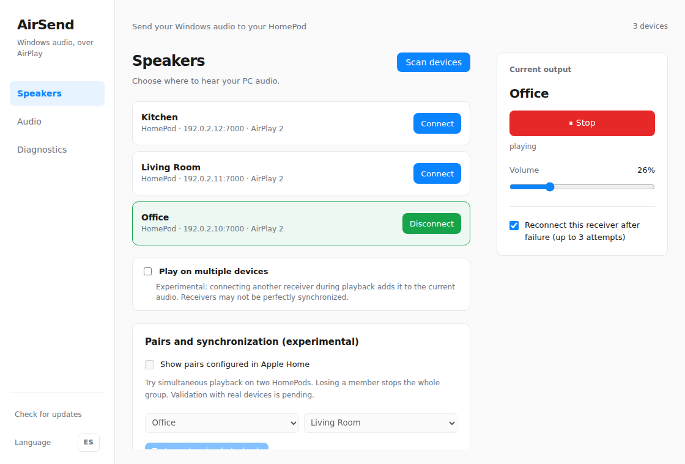
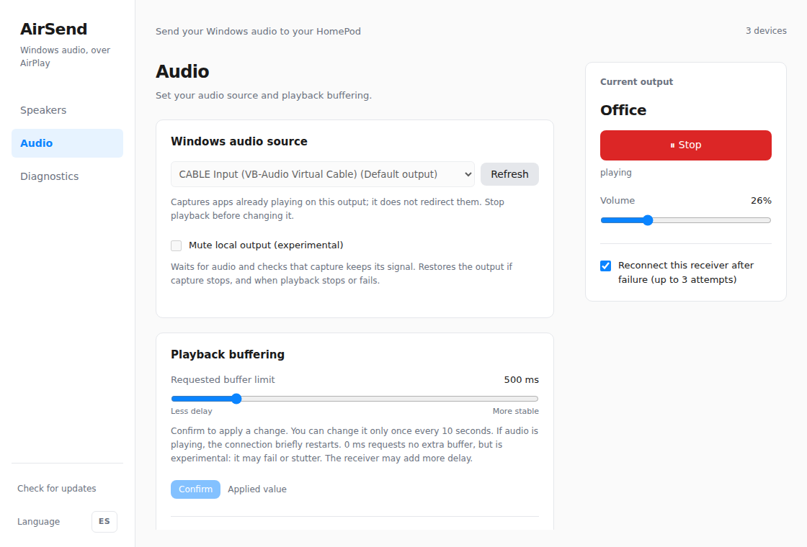
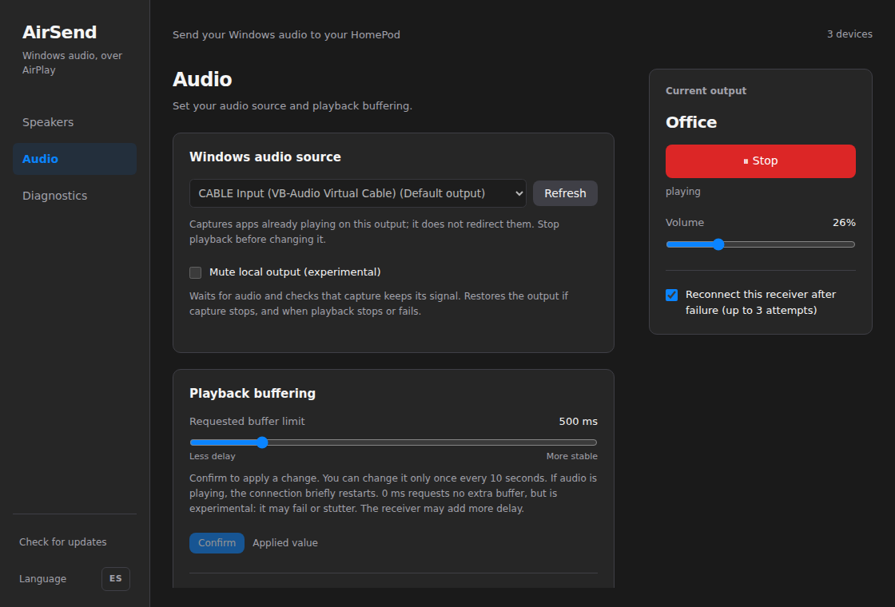

# Desktop navigation and layout

The previous 420 × 540 layout placed controls in a vertical list with collapsed
settings. This UI-only contribution opens a 1120 × 760 window (880 × 620 minimum)
with a sidebar for Speakers, Audio and Diagnostics, plus a persistent playback
panel. Group/manual-speaker settings and audio settings are directly accessible
within their pages. English/Spanish labels and light/dark themes are retained.

Navigation changes local view visibility and accessible current-page state only.
It does not start/stop playback, disconnect receivers or save preferences. Empty
states explain when a receiver must be selected before its buffering controls
are available. Existing source locking and the upstream 100 ms slider steps,
zero option, defaults and backend commands remain unchanged.

This branch is based directly on upstream main and is independent of the draft
HomePod OS 27 audio contribution in PR #28. It changes no audio backend code,
Cargo dependency, timing policy or persisted audio-option schema. The only
native configuration change is the window size/minimum. Product identifier and
release version are unchanged.

## Anonymized UI previews

These captures render the actual built frontend with a test-only native bridge.
Generic room names and documentation-only addresses (`192.0.2.x`) replace all
personal device information before rendering. No real names, network details,
account information or logs are included. They demonstrate layout, not a live
receiver or acoustic performance. The displayed 500 ms is demo fixture data.







## Validation and reproduction

```sh
npm --prefix ui ci
npm --prefix ui test
npm --prefix ui run build
npm exec --prefix ui -- playwright install chromium
npm --prefix ui run test:ui
node ui/tests/screenshots.cjs
```

The six existing device tests and TypeScript/Vite build are retained. Chromium
smoke coverage verifies navigation preserves streaming/preferences; controls
remain locked while playing; stop/source changes work; English/Spanish labels,
empty states, light/dark renders and minimum desktop sizing behave correctly.
It also checks that the audio-only legacy timing control is absent and the
upstream slider step remains 100 ms. Windows CI runs this harness before the
existing Rust/build/installer checks.

The previous combined candidate was installed and visually tested on Windows.
This extracted branch reruns frontend unit, build and smoke validation; GitHub
Windows CI should be checked separately before merging.
