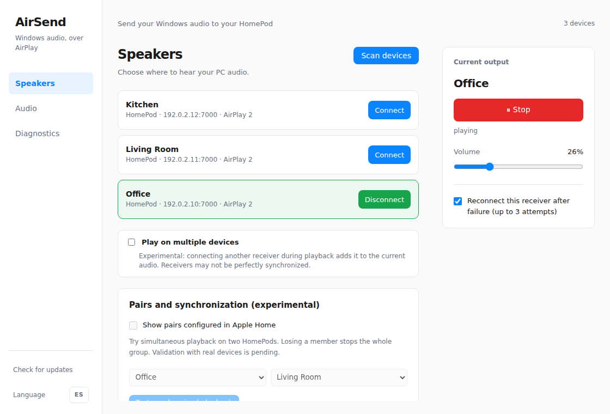
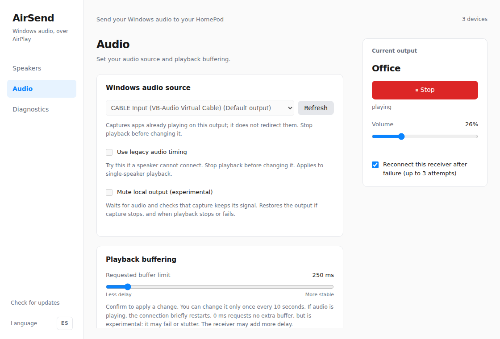
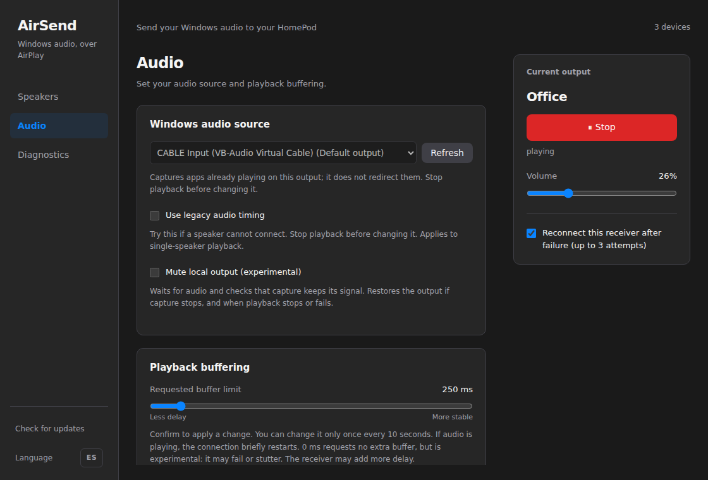

# HomePod OS 27 audio and desktop UI contribution

This contribution follows the existing integration at `e93535b`. A HomePod
running software 27.2 would connect but had excessive delay or crackling when
lower buffers were requested with the previous timing path. In the tested
Windows setup, automatic PTP timing and capture/timeline recovery allowed clean
playback with acceptable video sync at a **250 ms requested receiver buffer**.
That setting is not a measured end-to-end acoustic delay or a gaming latency
guarantee. Results need validation on other receivers and networks.

## Relationship to existing upstream work

Upstream draft [PR #26](https://github.com/Pabldi08/AirSend/pull/26) already
addresses HomePod OS 27 connection/timing and idle audio. This contribution
overlaps those fixes and adds the tested desktop UI, WASAPI packet draining,
legacy timing override, timing diagnostics and further regression coverage.
Its automatic PTP choice is narrower (supported HomePod models on OS 27+)
than #26's feature-based selection for all PTP-capable receivers. The maintainer
should reconcile those policies and dependency changes rather than merge both
implementations blindly.

Upstream draft [PR #27](https://github.com/Pabldi08/AirSend/pull/27) separately
removes the zero receiver-buffer option. This contribution retains main's
existing zero option; the 50 ms step support is not evidence that zero works.
It does not supersede #27's migration and minimum-buffer fix.

## Audio changes

- Select PTP for PTP-capable `AudioAccessory` receivers advertising software
  version 27 or newer. Older, unknown and other receivers retain NTP. A saved
  legacy-timing option allows single-speaker playback to force NTP.
- Retain receiver metadata needed for that choice. Diagnostics report the actual
  timing protocol rather than assuming NTP.
- Validate PTP exchanges by sequence, peer identity, domain, age and advancing
  timestamps; retain one-way clock tracking if two-way replies stop.
- Recover the RTP timeline after capture gaps rather than retaining a stale
  playback schedule.
- Drain all available WASAPI packets per notification, explicitly zero silent
  packets, and catch up idle silence after timer wakeups. Capture diagnostics
  include discontinuities, timestamp errors and observed frame rate.
- Allow 50 ms receiver-buffer steps and keep the requested minimum no greater
  than the maximum at small settings. The stable default and opt-in reduced
  local-buffer policy are retained.

The sender is vendored from
[DavidTIBO/airplay2-rs](https://github.com/DavidTIBO/airplay2-rs) revision
`9edef3287ae1ade1248ea4f18f1bc41a8780005b`, based on the project's existing
`Pabldi08/airplay2-rs` revision `dc66e2b`. Credit for the receiver compatibility
and initial PTP fixes belongs to DavidTIBO. Additional exchange validation and
RTP regression cases are included here. The original license and exact
provenance are retained in `vendor/airplay2-rs/PROVENANCE.json` and `LICENSE`.
The Unix socket-QoS guard and Windows sender priority support remain present.
Vendoring makes the tested combination reproducible; maintainers may prefer to
land those changes in their sender fork and restore a pinned Git dependency.

## Desktop changes

The window opens at 1120 × 760, with an 880 × 620 minimum. A sidebar separates
Speakers, Audio and Diagnostics. The playback panel stays visible while switching
pages. Previously collapsed settings are directly accessible within their pages;
English/Spanish labels, light/dark themes and stream-state locking are covered
by the UI tests. The product identifier and upgrade identity are unchanged.

### Screenshots

These are captures of the actual built frontend using its test-only native
bridge. Receiver names are generic demo labels and addresses are documentation
placeholders (`192.0.2.x`), replacing all personal device information before
rendering. They are UI previews, not evidence of a live receiver connection.
No real names, device identifiers, addresses, Windows account details or logs
were used in these images.

Reproduce with `npm --prefix ui ci`, `npm --prefix ui run build`,
`npm exec --prefix ui -- playwright install chromium`, then
`node ui/tests/screenshots.cjs`.

## Validation

The Windows alpha.6 candidate from which this contribution was prepared passed:

- 33 application/workspace Rust tests on Linux and Windows.
- 254 sender clock/audio Rust tests on Linux and Windows, with two existing
  ignored tests.
- Eight UI regression tests, TypeScript/Vite build and Chromium desktop smoke
  coverage for navigation, playback state, source locking, legacy timing,
  localization and sizing.
- Windows release build and NSIS installation, preserving existing preferences.
- Eleven microphone-calibration helper tests on Windows.

Listening tests on the HomePod 27.2 setup reported near sync with faint crackling
at 200 ms, then clean sound, acceptable sync and clean resume after pausing at
250 ms, with reduced local buffers enabled. Volume/mute worked with the existing
VB-CABLE route. No acoustic latency figure was established for the final profile.
The screenshots are independent from those listening tests. The contribution
branch reran all 33 application tests, 254 sender tests (two ignored), eight UI
tests, the UI production build and Chromium smoke checks successfully on Linux.
GitHub CI results should be consulted on the PR before merging.

The optional `tools/audio-latency` microphone helper saves numerical results,
not recordings. Its README describes setup and measurement limitations.

## Limits and review choices

- This remains realtime ALAC/PTP. It does not implement Apple's newer responsive
  audio transport and does not promise zero latency or universal gaming sync.
- Windows output selection captures the chosen output; it does not install or
  bundle a virtual audio driver or automatically reroute applications. A working
  separately installed virtual cable can avoid simultaneous physical playback.
- Multi-receiver synchronization, older HomePods, Apple TV and third-party
  receivers still need hardware testing. The legacy override only applies to
  single-speaker playback.
- Repository release versions are left unchanged for the maintainer to choose.
  Independent AAC/OpenAir research and local settings/logs are excluded.
- The audio and UI portions can be split if that would make upstream review
  easier. The vendored sender accounts for most of the added source lines.
